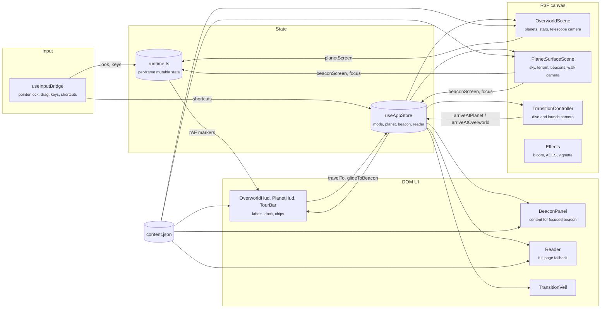
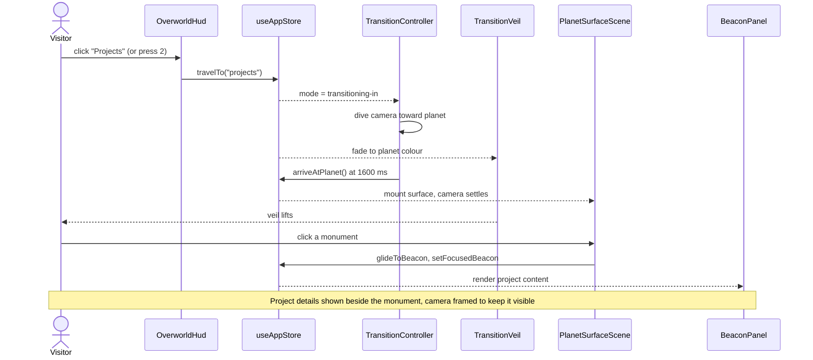

# John Mannully, portfolio

An interactive portfolio rendered in Three.js. You look through a telescope at five planets (About, Projects, Awards, Skills, Contact), dive into one, and walk its surface to read the monuments standing on it. Everything is also available as a plain, readable page through "Read as page".

Built with Vite, React 18, TypeScript, React Three Fiber, drei, postprocessing, zustand and Tailwind.

## Controls

| Where | Desktop | Touch |
| --- | --- | --- |
| Orbit | Move the mouse to look, drag to pan, click a planet or press 1 to 5 | Drag to look, tap a planet |
| Surface | The cursor locks on landing: move the mouse to look, WASD or arrows to walk, Shift to run, click the monument under the crosshair. Esc frees the cursor, a click on the scene locks it again | Joystick to walk, drag to look, tap a monument |
| Anywhere | R opens the reader, Q or Esc goes back | Back and Read buttons |

## Architecture

The app is one WebGL canvas plus a DOM layer on top. A single zustand store holds the scene mode and selections; per-frame data (pointer, drag, keys, projected screen positions) lives in plain mutable objects so the render loop never triggers React renders.



Scene modes always move in this order:

1. `overworld`: telescope view, where the site opens. Hovering a planet (in 3D or in the dock) highlights it; clicking calls `travelTo`.
2. `transitioning-in`: the camera dives toward the drifting planet. The veil fades to the destination sky colour from 1200 ms and the mode switches at 1600 ms, always under full cover.
3. `planet`: the camera settles from above onto the spawn point and the veil lifts. On desktop the cursor is locked for mouse look (released whenever the reader or the tour needs it). Walking near or looking at a monument focuses it and opens its panel.
4. `transitioning-out`: the camera launches upward, the veil covers at 900 ms and the mode returns to `overworld` at 1500 ms. Planet-to-planet travel is chained: the launch is cut at 900 ms and the next landing happens 450 ms later, all under the veil.



Guarantees and limits:

- Content lives only in `src/data/content.json`. The 3D monuments, the HUD chips, the panel and the reader are all generated from it.
- Planet and beacon layout is computed, not authored: planets are fitted to the viewport (a horizontal arc on landscape, a zig-zag on portrait) and beacons sit on a 94 degree arc in front of the spawn point.
- Without WebGL (or if the context is lost or the 3D tree throws), the canvas is never mounted and the reader becomes the whole site.
- The URL hash mirrors the view (`#/projects/proj-iris`, `#/read/awards`), so any planet, monument or reader section can be linked, and the browser Back button moves between planets.
- The render loop pauses while the reader is open.
- `prefers-reduced-motion` replaces camera flights with a short crossfade and removes head bob.
- Each surface matches its planet from orbit: basalt and lava rifts on Awards, an island in shallow water on Skills, a mesa above a cloud deck on Projects. Walking is clamped to 30 units, or to the island or mesa edge.
- Post-processing renders in linear HDR with ACES tone mapping; only values above 1.0 bloom (sun, lava, glints, focused seams). Touch devices drop multisampling and film grain.

## Getting started

```bash
npm install
npm run dev      # http://localhost:5173
npm run build    # type-checks and builds to dist/
npm run preview  # serves the production build
```

To change what the site says, edit `src/data/content.json`. Each planet lists its beacons; a beacon's `kind` (`profile`, `project`, `award`, `skills`, `link`) decides how it is drawn and how its content is rendered.
