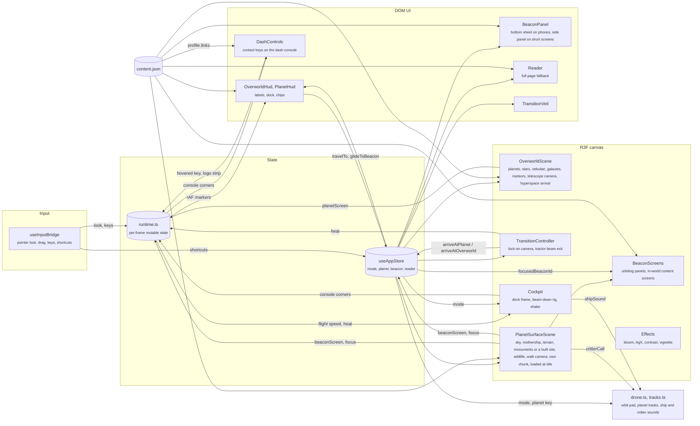
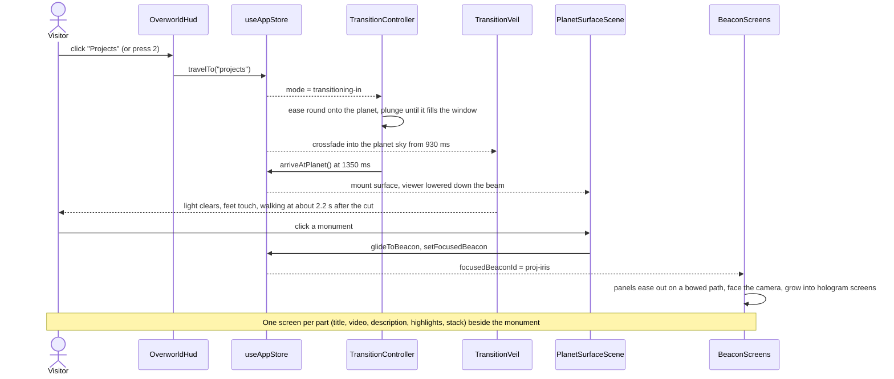

# John Mannully, portfolio

An interactive portfolio rendered in Three.js. You look out of a ship's observation deck at three planets (About, Projects, Awards), fly down to one, and walk its surface: past monuments on Projects, through a temple of statues on Awards, and around a small base camp on About. Everything is also available as a plain, readable page through "Read as page".

Built with Vite, React 18, TypeScript, React Three Fiber, drei, postprocessing, zustand and Tailwind.

## Controls

| Where | Desktop | Touch |
| --- | --- | --- |
| Orbit | Move the mouse to look, drag to pan, click a planet or press 1 to 5 | Drag to look, tap a planet |
| Surface | The cursor locks on landing: move the mouse to look, WASD or arrows to walk, Shift to run, click the monument under the crosshair. Esc frees the cursor, a click on the scene locks it again | Joystick to walk, drag to look, tap a monument |
| Anywhere | R opens the reader, Q or Esc goes back | Back and Read buttons |

## Architecture

The app is one WebGL canvas plus a DOM layer on top. A single zustand store holds the scene mode and selections; per-frame data (pointer, drag, keys, projected screen positions) lives in plain mutable objects so the render loop never triggers React renders.



Scene modes always move in this order:

1. `overworld`: the view from the ship's observation deck, where the site opens. The camera turns inside a fixed cockpit (bulkhead, canopy window, dashboard with a console standing across it), and the planet layout is fitted to 84% of the lens so every planet stays inside the window. Hovering a planet (in 3D or in the dock) highlights it; clicking calls `travelTo`. The sky is baked once into a cube map: a faint blue floor, the galactic band with star clouds and dust lanes, and four emission nebulae (warped fbm gas, bright knots, dark dust). Over it sit 9000 stars (the brightest with diffraction spikes), three distant spiral galaxies (additive shader planes 170 units out), and a meteor that streaks across the window every few seconds (off with reduced motion). Planets are lit with a soft wrapped terminator, a faint starlight fill on the night side and a bright scattering limb. The console across the dash, under the window, holds the contact keys: one key per entry in `profile.links` (Email, GitHub, Devpost, LinkedIn, X and the resume PDF on Google Drive), each shown as the link's logo. In orbit the console is drawn as a row of key faces (an inset frame, a status light and the logo per cell, the hovered or focused cell glowing) and in flight as a live instrument; switching to the keys, a bright edge sweeps across it over 1.6 s with the faces behind it and the logos a beat later, and back to the instrument in 0.5 s. The logos are painted on the face itself, so they stay fixed to the dash as the view turns: `DashControls` renders the icons once, draws them into a strip (`dashPanel.logos`) and the cockpit uses it as the face's texture. The links themselves are invisible keys laid over the cells: the cockpit projects the face's corners to the screen each frame (`dashPanel.quad`) and each key is clipped to its cell's exact outline. The top bar holds only Read as page; Sound sits bottom left (in the top bar on phones under 400px wide). On screens under 500px tall there is no room under the console, so the planet dock moves up into the top bar.
2. `transitioning-in`: the ship comes round onto the planet and plunges at it. The turn eases in and out over 650 ms and follows the planet on its orbit, and the deck keeps its place around the eye with a slight lag (so a planet at the edge of the window is never snapped to). The lens narrows 4 degrees as it locks on. From 150 ms the ship accelerates toward the planet and stops 1.4 radii from its centre, so the planet grows until it fills the window. The lens opens 9 degrees with the speed, speed lines and a rumble come with it, and the planet's air glows faintly on the canopy rim. From 930 ms the view crossfades over 380 ms into that planet's sky, and the mode switches at 1350 ms under full cover.
3. `planet`: the light clears over 700 ms while the viewer is lowered down the beam from the mothership. The rig places the eye along the line from the spawn to the ship's belly at the exit's pull curve run backwards (about 84 units up the beam at the start, slowing to a crawl over 1500 ms), looking up at the ship with the roll unwinding, then floats the last half unit onto the ground while the view comes down to the field ahead. PlanetCamera publishes the spawn as the beam's foot, so the beam lands where the viewer stands, and it fades out by 2200 ms, when walking starts. The landing clock runs on frame time capped at 100 ms per frame, so a first-frame stall on shader compiles cannot skip the landing. The mothership cruises prow first around a wide loop overhead (95 by 55 units, about 240 up and 165 ahead, about 2.5 units a second), out of view at rest and in view once you look up past about 40 degrees. On desktop the cursor is locked for mouse look (released whenever the reader opens). Walking near or looking at a monument focuses it. A monument chosen by a click, the HUD or a glide stays focused until the viewer moves a unit away, even when the glide ends nearer a neighbour (as it does across the temple aisle). On desktop its orbiting panels (dark, near-solid plates that read from across the field) fan out into screens once the viewer is within 7.5 units; on phones and portrait tablets the bottom sheet opens instead, and on screens under 500px tall (landscape phones) a side panel, since the screens would shrink past reading size there.
4. `transitioning-out`: the viewer is beamed back up. The camera turns to look at the mothership's belly (700 ms) while a tractor beam fades in (an additive tube of rising rings and streaks, with a pulsing pad at the feet); from 650 ms the viewer floats off the ground and is pulled along the beam with an accelerating, slowly rolling climb. The veil flashes the beam's light from 1550 ms and the mode returns to `overworld` at 2000 ms, so the lobby comes up out of the light. The cockpit stays hidden for the whole exit. Planet-to-planet travel is chained: the beam veil covers at 1350 ms, the mode switches at 1750 ms and the next landing happens 450 ms later under the veil.



Guarantees and limits:

- Content lives only in `src/data/content.json`. The 3D monuments, the HUD chips, the panel and the reader are all generated from it.
- Planet and beacon layout is computed, not authored: planets are fitted to the viewport (a horizontal arc on landscape, a zig-zag on portrait) and beacons sit on a 94 degree arc in front of the spawn point.
- Without WebGL (or if the context is lost or the 3D tree throws), the canvas is never mounted and the reader becomes the whole site.
- The planet surface is its own chunk (`loadSurface.ts`), so first load and the arrival do not parse it: it is fetched when the browser is idle after the arrival, or at once when a trip starts. If a dive ever finishes before it is in, the dive holds its covered last frame until it is. The shadow map is switched on at startup regardless, so loading the chunk never recompiles the orbit's materials.
- Frame loops do not read layout or rewrite unchanged styles: screen content sizes come from a ResizeObserver, HUD markers and screens write a style only when its value changes, the contact keys are laid out again only when the console moves half a pixel, and colours used per frame are parsed once.
- Touch: hover styles apply only where a pointer can hover, taps fire without the double-tap wait, controls never select on a long press, small HUD buttons have a 48px hit area, and the phone sheet is sized in `dvh` so it never hides under the browser's URL bar.
- Planet names in orbit read as an alien inscription (`AlienName`): carved capitals (Cinzel) under a faint line of the same name in Elder Futhark runes (Noto Sans Runic) in the planet's accent. When the names first fade in each starts as runes and resolves letter by letter, as if translated (55 ms apart, scrambling 260 ms first), and a hover replays it in 140 ms. Each letter keeps the width of its English form while it scrambles, so the label never shifts. Reduced motion shows the names plainly.
- Site basics: the tab title follows the view ("Iris · Projects · yo its john", "Read · yo its john"); `public/` has a themed `404.html`, `robots.txt`, `sitemap.xml`, `site.webmanifest` with 192 and 512 px icons, and a 32 px PNG favicon beside the SVG one. Vercel Web Analytics (cookieless page views) loads on the deployed site only. Nothing else is collected, and contact is by mail links, so there is no privacy policy to show.
- The URL hash mirrors the view (`#/projects/proj-iris`, `#/read/awards`), so any planet, monument or reader section can be linked, and the browser Back button moves between planets.
- The render loop pauses while the reader is open, and the music fades out over about a second; once it is silent the audio clock stops, and closing the reader wakes it and fades the music back in. The reader is a docs-style page on pure black: a header with the name, a Resume button and Close, a left section nav (tabs with a sky-blue underline on phones), a 660px content column in Inter with grey body text and Commit Mono labels, chips and square buttons, and an "On this page" list for the section in view (wide screens only). Its styles live in `src/ui/reader.css` under `.docs`, so the screens on the planets keep their own look.
- The site opens on a terminal screen drawn by `index.html` before any script runs, seen from the observation deck: the deck around the window is painted to a canvas by the inline script from the same outline and offsets the 3D cockpit uses (`shape.ts`: the bulkhead's seamed plates and rivets, the raised frame with its rivets and light strip, the console on the dash), so the viewer is in the ship from the first frame and the 3D deck lines up under the painting. The window is a terminal screen (faint scanlines and glow) whose lines, in the system's monospace font, type or print one after another over about four seconds: a deep-space scan, "NEW STAR SYSTEM DETECTED: MANNULLY", a course set, "DESTINATION SET.", and a blinking "press any key to launch" ("tap to launch" on touch screens). It is plain text and CSS, so it shows with the page. Any key or tap launches: the terminal clears behind a burst of light, and hyperspace (a deep blue and violet tunnel with two sets of ribs turning opposite ways, a far field of coloured streaks with fading tails in three copies zooming past, a near field rushing by faster, and a pulsing core; the streak images are drawn once and encoded off the critical path, since they are only seen after the launch) fills the window and runs the whole jump while the whole view sways a few pixels, like the shudder after the drop, so nothing that loads later can cut into it. That gesture is also what browsers need before a page may play sound, so the inline script makes the audio context inside it (`window.__bootAudio`) and `drone.ts` builds on it, so the warp is heard from the start even when the bundle arrives after the press. A link to a planet or the reader, or reduced motion, skips the launch: the loader fades as soon as the app is up. Only transform, opacity and filter animate, so the compositor runs it all while the app loads underneath.
- `Warp` (in the overworld scene, after `TelescopeCamera` and before the cockpit rig) keeps the time of the arrival. The system renders under the loader all along, so it is compiled and drawn before anyone sees it. Once the visitor has launched and the scene has drawn three frames (never later than 15 s after the launch), hyperspace runs on for at least 1.2 s, and the whole jump lasts at least 2.6 s from the launch so a cached visit still sees it; a click, tap or key drops out within 450 ms. Planets ignore the pointer during the arrival, so that click never picks a planet. Then the drive spools for 560 ms (`spoolBoot`: the loader's hyperspace surges, shakes and goes white, the drop sound plays), and under the full flash the loader's picture is removed (`endBoot`): as the flash clears over 520 ms the deck and the system are there, the lens snaps 4 degrees narrow and settles over 1.1 s while the deck's shudder dies away (`warpFx.lens`, `warpFx.shake`, both zeroed once it settles), and 450 ms after the flash the HUD fades up over 1 s. Then the planet names fade in one by one (500 ms in, 220 ms apart, over 1.4 s each) and the console sweeps from its instrument chart into the contact keys left to right over 1.6 s. The store's `intro` flag hides the HUD until then; keys do nothing, and travel asked for meanwhile (a link, Back) is queued and starts as the arrival ends.
- The warp plays only on a plain visit to the lobby. A link to a planet or the reader, reduced motion and the no-WebGL page get the loader alone: the display reaches 100%, reads "Arrived", and fades.
- Sound: a held hyperspace roar (a rumble, a sweeping rush and a beating drive) and a drop-out cue (a rising whine into a deep boom and a falling rush). The warp sounds are synthesized in Web Audio, so there is nothing to download. The key or tap that launches unlocks audio, so the roar plays from the first frame of hyperspace.
- `prefers-reduced-motion` replaces camera flights with a short crossfade, removes head bob, shake and light streaks, and shows the cockpit only in orbit.
- The cockpit is drawn in front of everything but never takes a click (its meshes skip raycasting). Its shake and the ride down the beam are offsets the rig adds after the camera controllers and removes before the next frame, so controllers always see their own pose.
- On a planet the top bar holds only Back to orbit and Read as page. Links on a screen stay clickable, and with the cursor locked, a click with the crosshair on a screen's link or button presses it.
- Each surface matches its planet from orbit: basalt and lava rifts on Awards, a mesa above a cloud deck on Projects. Walking is clamped to 30 units, or to the island or mesa edge.
- Each planet has its own architecture, and its layout comes from it (`getBeaconPosition`, `getBeaconFacing`, `siteFor` in `sites/site.ts`):
  - Pillar styles (art deco towers on Projects; obelisks, classical columns, pagodas and gothic arches are available) put one monument per beacon on an arc facing the spawn, each a different form of the style by its index, with proportions from a hash of the id and a floating crown carrying its meaning (project glyph, award tier).
  - `temple` (Awards): an open-air temple at dawn on a raised floor (0.3 above the highest rock under it, foundation sunk below the lowest), reached by three steps, with five columns and a beam down each side and an eternal flame on a dais under a gate closing the aisle. Each award is a robed statue holding up an emblem of what was won (a scored shield for ShieldClaw, an eye for Iris, an endless knot for the CCC, a laurel for first place), in pairs down the aisle facing in across it. Each stands on a plinth with a bronze plaque (event, result, project and year, drawn to a canvas) between two braziers that flare as the statue takes focus.
  - `outpost` (About): a base camp at dusk. The beam sets the viewer down on a landing pad, and a worn path leads to a campfire where I sit on a log with a laptop on my lap (`sites/Camp.tsx`, modelled after photos of me in `sites/figure.ts`: a long oval face shaped from a sphere with a light shadow of stubble, a straight prominent nose, thick straight brows, rounded-rectangle dark navy frames, and thick black wavy hair in one mesh (a cap that follows the hairline and about 40 tapered locks: parted near the middle, curtains over the corners of the forehead, the sides over the tops of the ears); an open dark brown zip-up hoodie (a lathe with a gap down the front, zip tapes, a pull, drawcords and the hood bunched at the neck) over a baggy off-white tee, black cargo track pants with thigh pockets and elastic cuffs, and white sneakers). All three About beacons sit at the camp (`getBeaconPosition` puts them on one spot and the HUD draws one edge arrow for it): the first draws the camp and carries every one's screens, one panel per beacon holding all of its parts, and they open together beside me when any of them is focused. Within 7 units, or while the camp is focused, my head comes up from the screen and turns toward the viewer (up to about 63 degrees across and 31 up or down), and goes back to the laptop as they leave. A comms mast with a blinking light and a solar array stand off to the sides.
  - A site's built ground (the temple floor and steps, the pad) is part of the walkable height, so the viewer, the beacons and the wildlife stand on it. Its columns, dais, campfire, mast and array are colliders for the walker, buildings get a wider keep-out than monuments, and the ground they cover is kept clear of plants.
- Beacon screens are real DOM (drei `Html` in transform mode, portalled into `#screen-layer` between the canvas and the HUD), so links, the video and keyboard focus work. They lay out in up to four columns on a plane 3.2 units in front of the camera, on whichever side of the monument has room, inside a band so the whole block reads at a glance: no higher than 52% of the way from the centre of the view to its top, no lower than 72% of the way down or the ground (sampled along the plane, with 0.18 units of air), and no more than 86% of the way out to the side. The column count is the one that fits the band with the least shrinking, traded a little against how much of the band it fills, so a tall stack wraps sideways rather than climbing. They fold back past 8.5 units. Deployed screens have rounded corners and float, each bobbing and swaying slightly on its own rhythm. Each panel flies on a time-based ease-in-out (1.35 s out, 1 s back, 0.16 s stagger) along a slightly bowed path. Panels are drawn by a hologram shader (`hologram.ts`): distance to the morphing outline drives a noise-eroded, fizzing edge with specks, a rim glow, scanlines, a refresh band and a rare flicker, and each panel seeds its own scan angle and density, dot grid, edge width and tint.
- Wildlife is picked by planet style: hopping aliens and birds on About, glowing drifters on Projects, nothing on Awards. Birds are one instanced mesh with wing flaps in the vertex shader. The animals notice the viewer: walkers inside 13 units come over and follow at about 2.4 units, fanned out on their own sides, face the viewer when stopped, greet a viewer who stands still (deer prance and bob, hoppers spin-hop), skip back when rushed, and lose interest after 60 s or past 24 units. They walk around monuments and each other. Two birds swoop down to circle a viewer who stands still for 3 s and leave when the viewer walks on; drifters within 15 units hover around the viewer. A click on any animal makes it greet. Reduced motion keeps them still.
- Each planet has its own track (`src/audio/tracks.ts`), played by a look-ahead step sequencer (sixteenths, queued 300 ms ahead every 60 ms) on synthesised instruments, and it takes over from the orbit pad from the dive onward with a 2.5 s crossfade. About (dunes at sunset, F major, 84 bpm) is fingerpicked folk with Mixolydian turns, a shaker, a warm drone and kalimba answers. Projects (night over a gas giant, C# minor, 100 bpm) is a sixteenth-note synth arpeggio whose filter breathes over two bars, a pumping sub bass, a soft kick and long echoes. Awards (the molten world, E Lydian, 72 bpm) is brass swells, a taiko heartbeat, ember crackle and a bell line that climbs to the raised fourth.
- The orbit pad is synthesised (detuned saws through a slow lowpass and a generated reverb). It walks an eight-chord progression with voice-led triads and a bass (I vi IV V I iii ii V in major, i VI iv V i III VII V in minor, harmonic-minor V), so every phrase cadences home; each V holds a suspended fourth and resolves it halfway through, and soft chimes land on chord tones. Chords last 11 s with a 3.2 s overlap. Music sits at 0.08 gain in orbit against 0.2 on a planet. The tractor beam has its own sounds (a thrum and rising shimmer as it takes hold in the lobby, a falling hum and a soft settle on the way down, a rising hum and whoosh on the way up). Animal calls (chirp, squeak, mew, boop) are short synthesised sweeps levelled by distance, panned around the camera and rate-limited. It starts on the first click or key press; the Sound toggle is stored in `localStorage` and suspends the audio context when off.
- Type is one self-hosted family, Archivo (expanded cut for display, normal for text), with JetBrains Mono only for key caps and handles. No font CDN.
- Post-processing renders in linear HDR with AgX tone mapping and a light contrast lift; only values above about 0.9 bloom (sun, bright stars, lava, glints, focused seams). Touch devices drop multisampling and film grain.

## Getting started

```bash
npm install
npm run dev      # http://localhost:5173
npm run build    # type-checks and builds to dist/
npm run preview  # serves the production build
```

To change what the site says, edit `src/data/content.json`. Each planet lists its beacons; a beacon's `kind` (`profile`, `project`, `award`, `skills`, `link`) decides how it is drawn and how its content is rendered. Contact links live in `profile.links` and feed the console keys and the reader header.
