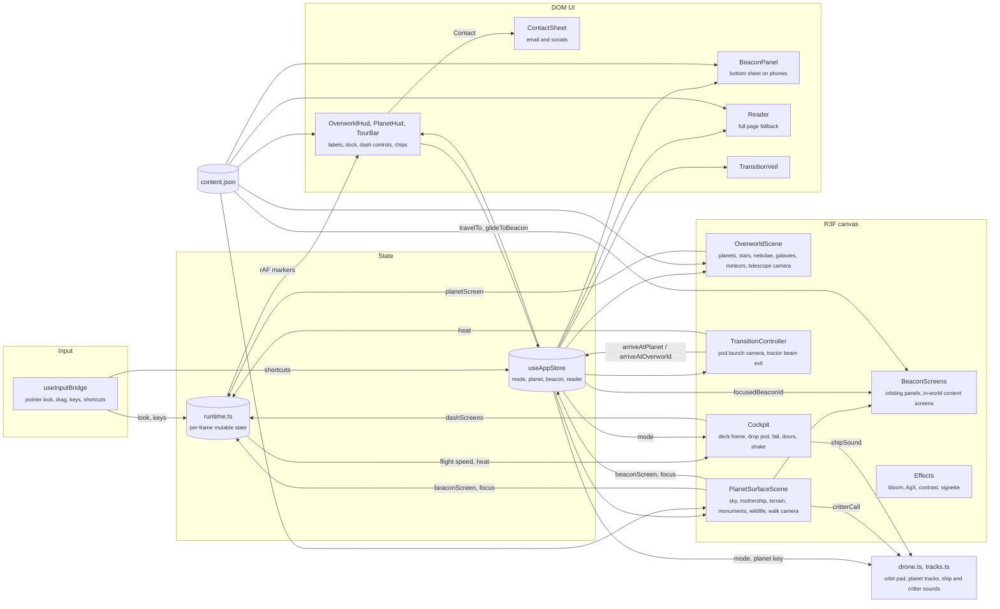
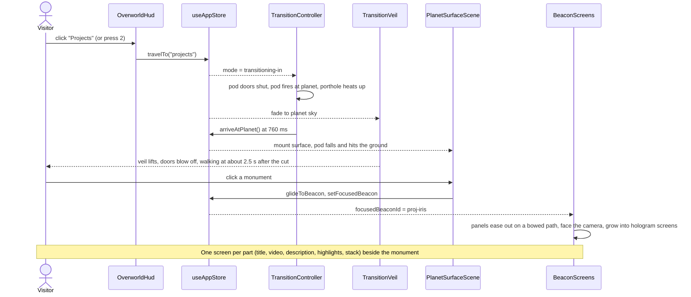

# John Mannully, portfolio

An interactive portfolio rendered in Three.js. You look out of a ship's observation deck at three planets (About, Projects, Awards), fly down to one, and walk its surface to read the monuments standing on it. Everything is also available as a plain, readable page through "Read as page".

Built with Vite, React 18, TypeScript, React Three Fiber, drei, postprocessing, zustand and Tailwind.

## Controls

| Where | Desktop | Touch |
| --- | --- | --- |
| Orbit | Move the mouse to look, drag to pan, click a planet or press 1 to 5 | Drag to look, tap a planet |
| Surface | The cursor locks on landing: move the mouse to look, WASD or arrows to walk, Shift to run, click the monument under the crosshair. Esc frees the cursor, a click on the scene locks it again | Joystick to walk, drag to look, tap a monument |
| Anywhere | R opens the reader, Q or Esc goes back | Back and Read buttons |

## Architecture

The app is one WebGL canvas plus a DOM layer on top. A single zustand store holds the scene mode and selections; per-frame data (pointer, drag, keys, projected screen positions) lives in plain mutable objects so the render loop never triggers React renders.



Scene modes always move in this order:

1. `overworld`: the view from the ship's observation deck, where the site opens. The camera turns inside a fixed cockpit (bulkhead, canopy window, dashboard with two live displays), and the planet layout is fitted to 84% of the lens so every planet stays inside the window. Hovering a planet (in 3D or in the dock) highlights it; clicking calls `travelTo`. The sky is baked once into a cube map: a faint blue floor, the galactic band with star clouds and dust lanes, and four emission nebulae (warped fbm gas, bright knots, dark dust). Over it sit 9000 stars (the brightest with diffraction spikes), three distant spiral galaxies (additive shader planes 170 units out), and a meteor that streaks across the window every few seconds (off with reduced motion). Planets are lit with a soft wrapped terminator, a faint starlight fill on the night side and a bright scattering limb. The two dash displays are controls, drawn as plain key faces (an inset frame, a status light, a glow on hover) in orbit and as live instruments in flight: the cockpit projects their corners to the screen each frame (`dashScreens`) and DOM buttons follow them, Tour on the left and Contact on the right, which opens a card with email (with copy) and every social link. The top bar holds only Read as page; Sound sits bottom left.
2. `transitioning-in`: the viewer drops in a pod instead of flying the ship. The view swings onto the planet in 280 ms while the pod's two doors slam shut from the sides over 240 ms, leaving a round porthole split down the seam (the doors live in their own uniformly scaled group, so the porthole stays round at any aspect and shrinks on narrow screens). The cockpit is hidden once the doors meet. At 420 ms the pod fires: a 7 degree lens punch and a shake kick, then an accelerating fall toward the planet for 760 ms while the lens widens and light streaks rush past. The porthole glass burns with entry plasma in the planet's accent, the veil fades to the destination sky from 980 ms and the mode switches at 1180 ms, always under full cover.
3. `planet`: the pod drops from 95 units up and 22 behind, nose down and turning, braking all the way but still hitting hard after 1050 ms, while the veil clears in 380 ms and the porthole cools. Inside, the doors sit in a doorway in the pod's wall with a status lamp (red falling, amber after impact). On impact the pod digs in with a damped dip and a heavy shake, and a ring of dust (140 soft points, moved in the shader from the impact's age) rolls out along the ground and thins over 3.4 s. The lamp goes green, and at 1670 ms the bolts fire: the doors are thrown outward and away over about 260 ms, and from 18% of the 820 ms window the viewer walks 1.3 units out through the doorway, which passes the eye. Walking starts about 2.5 s after the cut. The landing clock runs on frame time capped at 100 ms per frame, so a first-frame stall on shader compiles cannot skip the landing. The mothership is already overhead: it cruises prow first around a wide loop (95 by 55 units, about 240 up and 165 ahead, about 2.5 units a second), out of view at rest and in view once you look up past about 40 degrees. On desktop the cursor is locked for mouse look (released whenever the reader or the tour needs it). Walking near or looking at a monument focuses it. On desktop its orbiting panels (dark, near-solid plates that read from across the field) fan out into screens once the viewer is within 7.5 units; on phones the bottom sheet opens instead.
4. `transitioning-out`: the viewer is beamed back up. The camera turns to look at the mothership's belly (700 ms) while a tractor beam fades in (an additive tube of rising rings and streaks, with a pulsing pad at the feet); from 650 ms the viewer floats off the ground and is pulled along the beam with an accelerating, slowly rolling climb. The veil flashes the beam's light from 1550 ms and the mode returns to `overworld` at 2000 ms, so the lobby comes up out of the light. The cockpit stays hidden for the whole exit. Planet-to-planet travel is chained: the beam veil covers at 1350 ms, the mode switches at 1750 ms and the next landing happens 450 ms later under the veil.



Guarantees and limits:

- Content lives only in `src/data/content.json`. The 3D monuments, the HUD chips, the panel and the reader are all generated from it.
- Planet and beacon layout is computed, not authored: planets are fitted to the viewport (a horizontal arc on landscape, a zig-zag on portrait) and beacons sit on a 94 degree arc in front of the spawn point.
- Without WebGL (or if the context is lost or the 3D tree throws), the canvas is never mounted and the reader becomes the whole site.
- The URL hash mirrors the view (`#/projects/proj-iris`, `#/read/awards`), so any planet, monument or reader section can be linked, and the browser Back button moves between planets.
- The render loop pauses while the reader is open.
- `prefers-reduced-motion` replaces camera flights with a short crossfade, removes head bob, shake and light streaks, and shows the cockpit only in orbit and no pod at all.
- The cockpit is drawn in front of everything but never takes a click (its meshes skip raycasting). Its shake and the pod's fall are offsets the rig adds after the camera controllers and removes before the next frame, so controllers always see their own pose.
- On a planet the top bar holds only Back to orbit and Read as page. Links on a screen stay clickable, and with the cursor locked, a click with the crosshair on a screen's link or button presses it.
- Each surface matches its planet from orbit: basalt and lava rifts on Awards, a mesa above a cloud deck on Projects. Walking is clamped to 30 units, or to the island or mesa edge.
- Every planet has one architecture for its monuments (obelisks, art deco towers, classical columns, pagodas, gothic arches), and each monument on a planet takes a different form of it by its index (for example column, twin columns with a beam, tholos and victory column on Awards). Proportions vary from a hash of the id, and the floating crown carries its meaning (award tier, project glyph).
- Beacon screens are real DOM (drei `Html` in transform mode, portalled into `#screen-layer` between the canvas and the HUD), so links, the video and keyboard focus work. They lay out in up to three columns on a plane 3.2 units in front of the camera, on whichever side of the monument has room, and shrink to fit the view. They fold back past 8.5 units. Deployed screens have rounded corners and float, each bobbing and swaying slightly on its own rhythm. Each panel flies on a time-based ease-in-out (1.35 s out, 1 s back, 0.16 s stagger) along a slightly bowed path. Panels are drawn by a hologram shader (`hologram.ts`): distance to the morphing outline drives a noise-eroded, fizzing edge with specks, a rim glow, scanlines, a refresh band and a rare flicker, and each panel seeds its own scan angle and density, dot grid, edge width and tint.
- Wildlife is picked by planet style: hopping aliens and birds on About, glowing drifters on Projects, nothing on Awards. Birds are one instanced mesh with wing flaps in the vertex shader. The animals notice the viewer: walkers inside 13 units come over and follow at about 2.4 units, fanned out on their own sides, face the viewer when stopped, greet a viewer who stands still (deer prance and bob, hoppers spin-hop), skip back when rushed, and lose interest after 60 s or past 24 units. They walk around monuments and each other. Two birds swoop down to circle a viewer who stands still for 3 s and leave when the viewer walks on; drifters within 15 units hover around the viewer. A click on any animal makes it greet. Reduced motion keeps them still.
- Each planet has its own track (`src/audio/tracks.ts`), played by a look-ahead step sequencer (sixteenths, queued 300 ms ahead every 60 ms) on synthesised instruments, and it takes over from the orbit pad from the dive onward with a 2.5 s crossfade. About (dunes at sunset, F major, 84 bpm) is fingerpicked folk with Mixolydian turns, a shaker, a warm drone and kalimba answers. Projects (night over a gas giant, C# minor, 100 bpm) is a sixteenth-note synth arpeggio whose filter breathes over two bars, a pumping sub bass, a soft kick and long echoes. Awards (the molten world, E Lydian, 72 bpm) is brass swells, a taiko heartbeat, ember crackle and a bell line that climbs to the raised fourth.
- The orbit pad is synthesised (detuned saws through a slow lowpass and a generated reverb). It walks an eight-chord progression with voice-led triads and a bass (I vi IV V I iii ii V in major, i VI iv V i III VII V in minor, harmonic-minor V), so every phrase cadences home; each V holds a suspended fourth and resolves it halfway through, and soft chimes land on chord tones. Chords last 11 s with a 3.2 s overlap. Music sits at 0.08 gain in orbit against 0.2 on a planet. The flight has its own sounds (the pod's doors running in and slamming, the launch kick, rising rush and entry rumble of the fall, wind and retro roar on the drop and a heavy impact, the bolts blowing the doors, and the tractor beam's hum). Animal calls (chirp, squeak, mew, boop) are short synthesised sweeps levelled by distance, panned around the camera and rate-limited. It starts on the first click or key press; the Sound toggle is stored in `localStorage` and suspends the audio context when off.
- Type is one self-hosted family, Archivo (expanded cut for display, normal for text), with JetBrains Mono only for key caps and handles. No font CDN.
- Post-processing renders in linear HDR with AgX tone mapping and a light contrast lift; only values above about 0.9 bloom (sun, bright stars, lava, glints, focused seams). Touch devices drop multisampling and film grain.

## Getting started

```bash
npm install
npm run dev      # http://localhost:5173
npm run build    # type-checks and builds to dist/
npm run preview  # serves the production build
```

To change what the site says, edit `src/data/content.json`. Each planet lists its beacons; a beacon's `kind` (`profile`, `project`, `award`, `skills`, `link`) decides how it is drawn and how its content is rendered. Contact links live in `profile.links` and feed the contact card and the reader header.
